# Project 1: AWS Foundation


**Status:** Done\
**Started:** 09-25-2026\
**Finished:** 10-21-2026

Built in nine phases, each one tracked as an issue in the [Project 1 milestone](https://github.com/Snowblind019/aws-platform/milestone/1).

The persistent layer every other stack in this repo builds on: two accounts, short-lived access only, one state backend, org-wide guardrails, and a keyless way in for GitHub Actions. It stays up between projects for under a dollar a month.

## Overview

Project 1 sets up the AWS side of the platform before anything gets deployed. An AWS Organization holds two accounts: the management account, which only holds org-level things like Identity Center, the audit trail, and the cost controls, and `lab`, where every later project deploys. People get in through IAM Identity Center with MFA, GitHub Actions gets in through OIDC, and neither path uses a stored key. Terraform state for every stack lives in one versioned, locked S3 bucket. On top of that sit the guardrails: three SCPs on the `Workloads` OU, an organization CloudTrail trail, budgets and anomaly alerts, cost allocation tags, safe account defaults in `lab`, and a daily check that fails if anything meant to be temporary is still running. Later stacks get the tags module, the shared backend config, and `foundation`'s outputs, so each project starts from the same base and can be torn down without touching it.

## Architecture

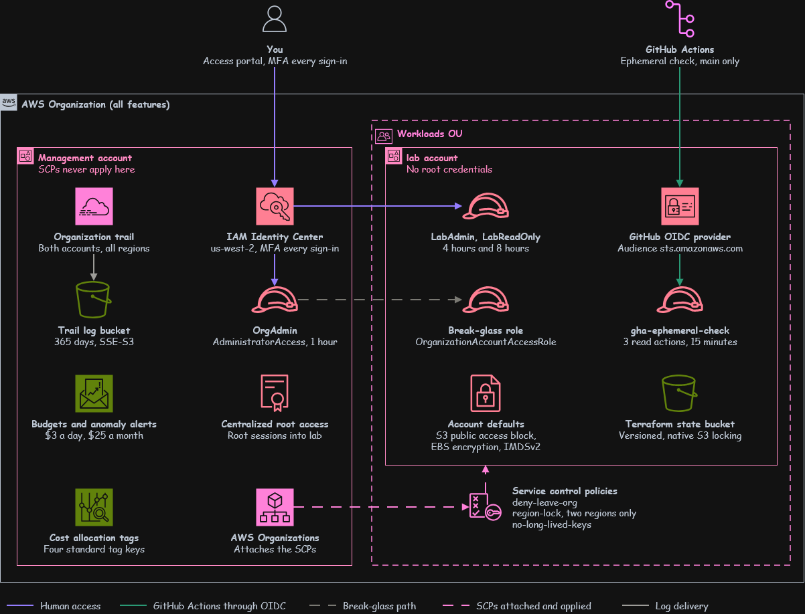

The management account holds Identity Center, the organization trail and its log bucket, and the cost controls. SCPs never apply to it, so nothing else gets built there. `lab` sits in the `Workloads` OU under all three SCPs and holds everything else: the state bucket, the account defaults, and the GitHub OIDC trust.

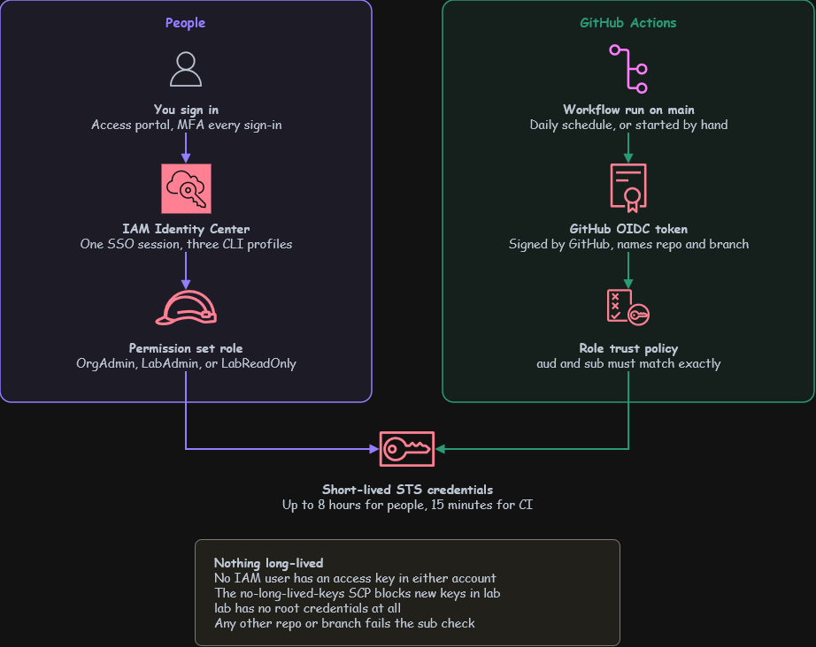

Every way into AWS ends in short-lived STS credentials. People sign in through Identity Center and get a permission set's role for 1 to 8 hours. GitHub Actions trades a signed OIDC token for 15 minutes on one read-only role, and only from `main`. No IAM user has an access key in either account, an SCP stops new ones being made in `lab`, and `lab` has no root credentials at all.

## Stacks

| Stack | Account | What it holds | Lifecycle |
|---|---|---|---|
| `bootstrap` | lab | The S3 bucket every stack keeps its state in, with versioning, SSE-S3, all four public access block settings, bucket owner enforced, a TLS-only policy, a lifecycle rule, and `prevent_destroy` | Persistent |
| `org` | management | The organization, the `Workloads` OU, and the `lab` account (all imported), three SCPs, the organization CloudTrail trail and its log bucket, budgets, anomaly detection, and cost allocation tags | Persistent |
| `foundation` | lab | Account defaults (S3 public access block, EBS encryption by default, IMDSv2 by default), the GitHub OIDC provider, and the read-only `gha-ephemeral-check` role. Reads `allowed_regions` from `org` | Persistent |
| `modules/tags` | n/a | No resources. It outputs the four standard tags, `Project`, `ManagedBy`, `Owner`, and `Ephemeral`, for each stack's `default_tags`, and validates the stack name | n/a |

## Accounts and access

The organization runs with all features enabled, since consolidated-billing-only mode can't use SCPs, tag policies, or trusted access for other services. It has two accounts. The management account holds only org-level resources, and `lab` is where every project deploys. `lab` sits in a `Workloads` OU under the root, and the guardrail SCPs attach to that OU rather than the root. Member account emails are plus-addresses of the management account's email.

The SCP policy type is enabled. AWS attached `FullAWSAccess` to the root, the OU, and both accounts, and it stays attached. The SCPs added later are deny statements on top of it, and detaching it would deny everything.

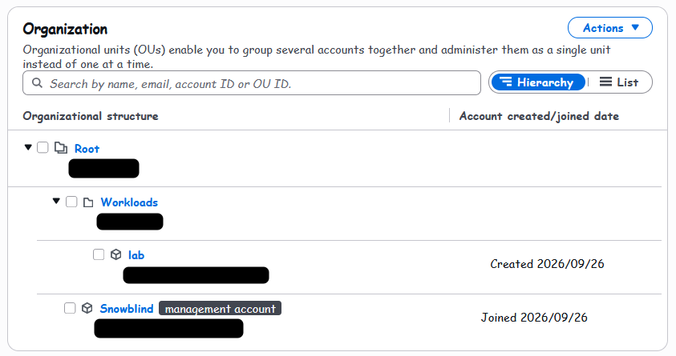

Centralized root access is on, with both of its features: root credentials management and privileged root actions in member accounts. It was turned on before `lab` was created, so `lab` came with no root credentials at all, no password and no access keys. When a task needs root, like unlocking an S3 bucket whose policy denies everyone, the management account opens a short-lived root session into `lab` instead of anyone signing in as its root user.

Once these features are on, the Root access management page in the console only lists the accounts, so the feature check below comes from the CLI.

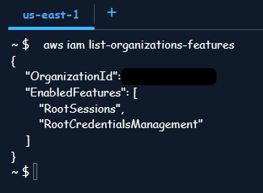

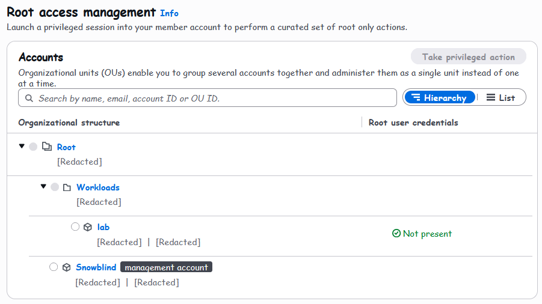

### Identity Center

People get into both accounts through IAM Identity Center, set up as the organization instance in `us-west-2`. MFA is required at every sign-in, not only when the device or location changes. Authenticator apps and security keys are both allowed, and anyone without a registered device has to register one before they can get in.

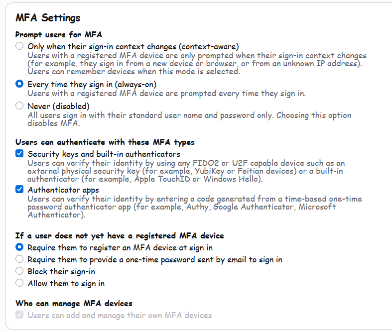

Access is assigned to a `platform-admins` group, not to my user directly, through three permission sets:

| Permission set | Policy | Session | Account | Used for |
|---|---|---|---|---|
| OrgAdmin | AdministratorAccess | 1 hour | Management | Org-level work only, the `org` stack |
| LabAdmin | AdministratorAccess | 4 hours | `lab` | Terraform work on every other stack |
| LabReadOnly | ReadOnlyAccess | 8 hours | `lab` | Looking around without write access |

AdministratorAccess is on purpose for now. Least privilege needs something built to be least-privileged against, so project 5 replaces OrgAdmin and LabAdmin with scoped custom permission sets and brings all of this into Terraform. Because access hangs off the group, that change is a matter of changing group assignments, with nothing to rewire per user.

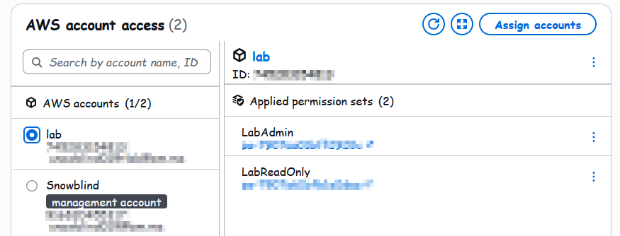

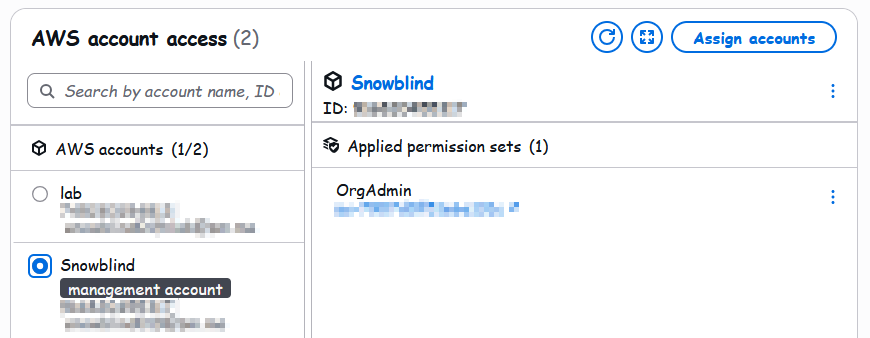

On the command line, one SSO session feeds three profiles, `mgmt-admin`, `lab-admin`, and `lab-readonly`, one per permission set. A single `aws sso login` covers all three, and each profile lands in the right account with the right permission set:

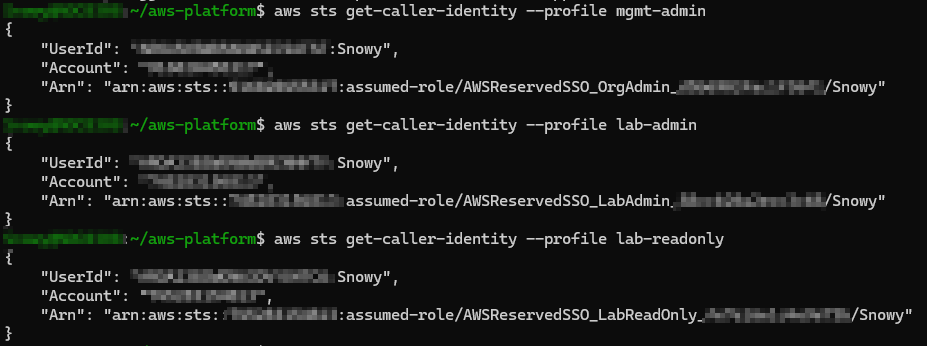

On the work machine, the session gets closed with `aws sso logout` at the end of each shift, which clears the cached tokens.

If Identity Center ever breaks, `lab` keeps the default `OrganizationAccountAccessRole`, which the management account can assume. It's the break-glass way back into `lab`.

### No long-lived keys

Every CLI call now uses short-lived credentials from the SSO session, so the old IAM user's access keys were deleted from the management account and from `~/.aws/credentials`. The credential report in both accounts shows no active access keys, root users included.

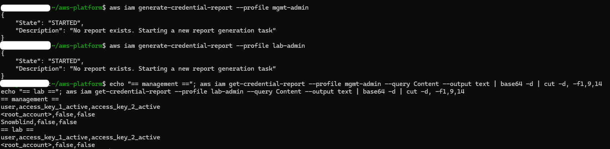

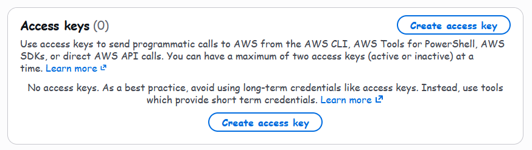

### Bringing the org under Terraform

The organization and `lab` were created by hand in the console, not with Terraform. Creating and closing accounts are one-way doors: a closed account sits in a post-closure period, and an organization can only close so many, so an account should never be anywhere near a `terraform destroy`.

They were adopted into the `org` stack afterward. That stack runs against the management account but keeps its state in the bucket in `lab`, so one run uses two sets of credentials. The backend reads and writes state with the `lab-admin` profile from `AWS_PROFILE`. The provider has its own `profile` argument set to `mgmt-admin`, which wins over the environment variable for the provider only. Every resource in the stack is in the management account, so the one-stack-one-account rule still holds. This stack never runs in CI: GitHub never gets a role in the management account, the one account SCPs can't restrict.

The organization, the OU, and the account were brought in with `import` blocks. Those go through `plan`, so the plan shows exactly what's being adopted, and whether Terraform wants to change anything, before any of it happens. The final plan read 3 to import, 0 to add, 2 to change, 0 to destroy. Both changes were `default_tags` adding the four standard tags to the OU and the account, plus two Terraform-only settings on the account going from null to false.

Getting there took one fix. The first plan wanted to remove `RESOURCE_CONTROL_POLICY` from the organization's enabled policy types: RCPs were enabled on the root, and the code only listed SCPs. Applying that would have disabled RCPs for the whole organization. The service access principals have the same trap, so that list was copied exactly from `aws organizations list-aws-service-access-for-organization`: IAM for centralized root access and SSO for Identity Center, with CloudTrail added later for the organization trail.

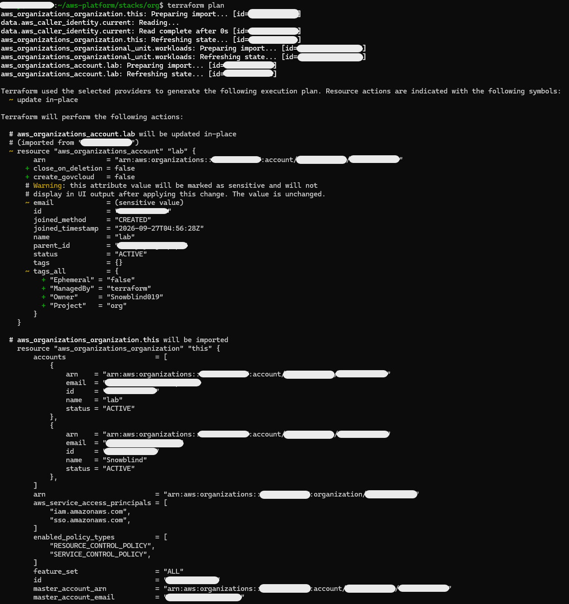

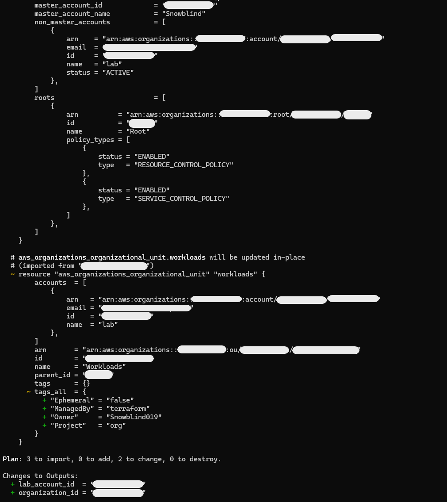

The account resource needed one more thing. Organizations only uses the break-glass role name when an account is created, and no API reads it back, so after an import Terraform sees a difference on `role_name`, and that attribute forces replacement. `ignore_changes` on `role_name` and `iam_user_access_to_billing` removes the false difference, and `role_name` stays in the code as a record of what exists. The account's email comes from a gitignored `terraform.tfvars` and is marked sensitive, so it never shows in the code or in plan output.

All three resources have `prevent_destroy`. Removing the account resource wouldn't close `lab`, it would pull it out of the organization and out from under every SCP. That safety net got used once for real: on a second machine, `terraform.tfvars` had the `lab` email typed slightly differently. A different email forces replacement, so the plan wanted to destroy `lab` and create a new account, and `prevent_destroy` stopped the plan before anything could be applied. Copying the exact address from `aws organizations list-accounts` fixed it.

The import blocks did nothing once the resources were in state, so they were deleted. At first the file was redacted instead of deleted, and it only came out in Phase 7. Its first version, with the real IDs, is still in the commit history. AWS doesn't treat these IDs as secret, so the history was left alone.

## State backend

Every stack keeps its state in one S3 bucket in `lab`, created by the `bootstrap` stack. Bootstrap is the one stack that can't start with a remote backend, because the bucket it would point at is the thing it creates. So it was applied once with local state, and then its own state was moved into the bucket it had just made.

The bucket is named `<prefix>-tfstate-<account-id>`. Bucket names are global, so the account ID keeps it unique, and it's read at plan time with the `aws_caller_identity` data source instead of being typed into the code. The bucket's settings:

| Setting | Value | Why |
|---|---|---|
| Versioning | Enabled | Every change to a state file keeps the old copy, so a bad write can be rolled back |
| Encryption | SSE-S3 | State can hold secrets in plain text. New buckets are encrypted by default, but declaring it shows the intent in code. There's no customer managed key yet |
| Public access block | All four settings on | The bucket can't be made public by accident |
| Object ownership | Bucket owner enforced | ACLs are off, so access comes only from IAM and the bucket policy |
| Bucket policy | Deny every request where `aws:SecureTransport` is false | Nobody can read or write state over plain HTTP |
| Lifecycle | Old versions expire after 30 days with the newest 5 always kept. Incomplete uploads are aborted after 7 days | Versioning with no lifecycle grows forever |
| `prevent_destroy` | On | Terraform refuses any plan that would delete the bucket |

Tags come from the shared `modules/tags` module, passed into the provider's `default_tags`, so every resource in the stack carries `Project`, `ManagedBy`, `Owner`, and `Ephemeral` without tagging each one by hand. The module checks that the stack name only uses lowercase letters, digits, and hyphens, and it has no default for `Ephemeral`, so every stack has to say on purpose whether it gets torn down.

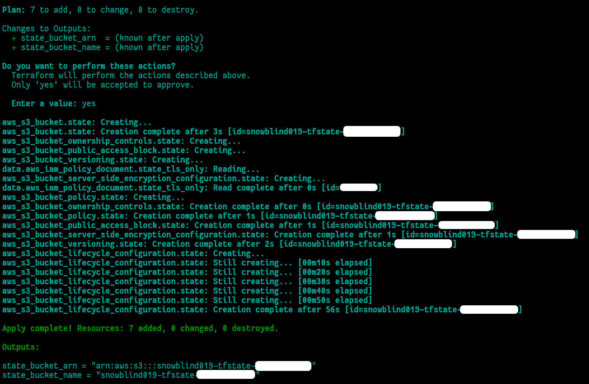

### Moving the state into the bucket

Stacks use partial backend configuration. The settings every stack shares (the bucket, its region, locking, and encryption) live in a gitignored `backend.hcl` at the repo root, and a committed `backend.hcl.example` shows its shape. Each stack's `backend "s3"` block holds only its own `key`, like `aws-platform/bootstrap/terraform.tfstate`. That keeps the bucket name, and the account ID in it, out of the repo. Backend blocks can't read variables anyway, so a file passed in at `terraform init` is how the settings get shared.

Bootstrap's state moved over with `terraform init -migrate-state -backend-config=../backend.hcl`. A plan afterward showed no changes, which proved Terraform was reading state from S3 and that it matched what was built. Only then were the local state files deleted.

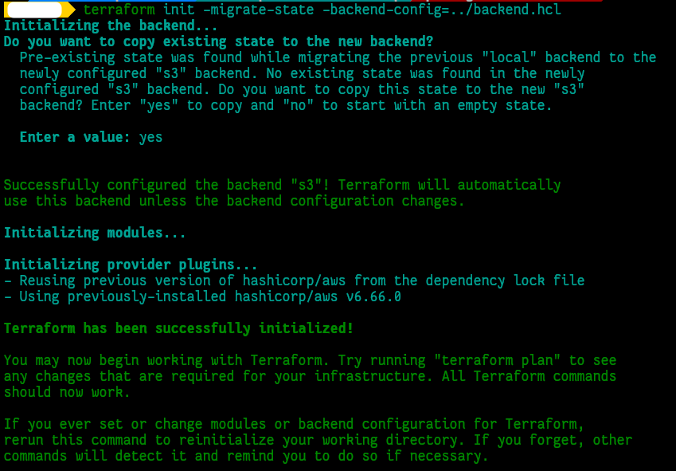

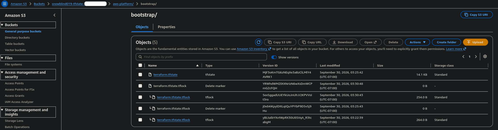

### Locking

Locking uses Terraform's native S3 lockfile (`use_lockfile = true`) instead of a DynamoDB table, which Terraform has deprecated for this. While a plan or apply runs, Terraform writes a `.tflock` object next to the state file, using a conditional write that only succeeds if that object doesn't already exist. When a second run tries, S3 rejects its write with a 412 PreconditionFailed, and Terraform reports it as a lock error.

To test it, one terminal ran `terraform apply -replace=aws_s3_bucket_ownership_controls.state` and left it sitting at the approval prompt. A plain `terraform apply` wouldn't have worked: with nothing to change, it prints No changes and exits without a prompt, so nothing holds the lock. `-replace` forces a plan with one change in it, and the ownership controls are harmless to recreate if the plan gets approved by mistake. While the first terminal waited, `terraform plan` in a second terminal failed with the lock error, showing the lock ID, the operation holding it, and when it was taken.

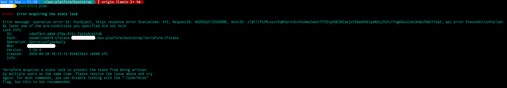

The lock object sat next to the state file for as long as the first terminal waited. Its timestamp, 11:11:14 local time, is one second after the lock's created time in the error, 18:11:13 UTC. Answering no in the first terminal released the lock, and the object was gone on the next refresh.

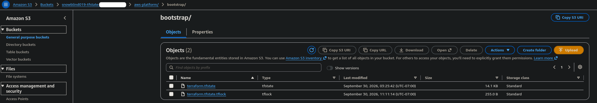

Because the bucket is versioned, S3 doesn't really delete the lock object when a run finishes. Each run leaves a small noncurrent version and a delete marker behind, and the lifecycle rule keeps those from piling up along with the old state versions.

If a crash ever leaves a lock behind, `terraform force-unlock <LOCK_ID>` removes it, but only after confirming nothing else is actually running. Unlocking while another run is writing state is how state gets corrupted.

### prevent_destroy

`terraform plan -destroy` in bootstrap lists all 7 resources for deletion, then stops with "Instance cannot be destroyed" pointing at the bucket. `prevent_destroy` is checked while the plan is built, so the whole plan fails and none of it can be applied, including the settings resources that aren't protected themselves. Deleting this bucket on purpose would mean moving every stack's state out of it first, removing `prevent_destroy`, and emptying every version before a destroy could run.

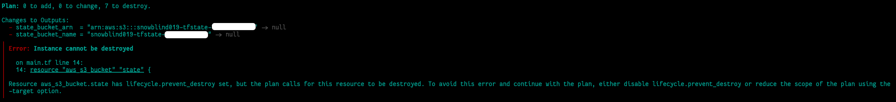

## Guardrails

### Service control policies

Three SCPs attach to the `Workloads` OU, as deny statements on top of `FullAWSAccess`. SCPs never grant anything. They set the ceiling on what IAM inside `lab` can grant, so even a role with AdministratorAccess can't do what an SCP denies. They don't apply to the management account or to service-linked roles.

| Policy | What it denies | Why |
|---|---|---|
| `deny-leave-org` | `organizations:LeaveOrganization` | An account that leaves the org drops every SCP at that moment, so the guardrails could be walked out of from inside |
| `region-lock` | Every action outside `us-west-2` and `us-east-1`, except a list of global services | Fewer regions means fewer places for mistakes and forgotten resources |
| `no-long-lived-keys` | `iam:CreateAccessKey` and `iam:CreateLoginProfile` | Humans come in through Identity Center and machines through OIDC, so there's never a reason for an IAM user credential in `lab` |

`region-lock` denies everything with a `NotAction` list that exempts global services like IAM, Organizations, STS, and Route 53, when `aws:RequestedRegion` isn't one of the two allowed regions. The exemption list was copied from the AWS Control Tower controls reference on 10-01-2026 rather than written from memory. The AWS Organizations user guide has an older version of the same example, missing `sso:*`, `tag:GetResources`, and several newer global services. The allowed regions come from one variable that feeds the policy and is also a stack output, so later stacks read the same list the SCP enforces. A validation on that variable requires `us-west-2`, where the state bucket and Identity Center live.

The policies are built with the `aws_iam_policy_document` data source, and each policy's content comes from its `minified_json`. When an SCP is created through the API, whitespace counts toward the size limit. `region-lock` is 2,891 characters pretty and 1,973 minified. The policies and their attachments are created with `for_each` over a map keyed by policy name, so a new SCP is one more map entry and gets attached the same way.

The `org` stack's state lives in `lab`, the account these SCPs govern. If `region-lock` were ever wrong in a way that blocked `lab` from S3 in `us-west-2`, Terraform couldn't read the state it would need to fix it. The way back in is detaching the policy in the Organizations console from the management account, which SCPs never reach. Right after the apply, a plan in `bootstrap` came back with no changes, which confirmed `lab` could still reach its state through the new policies.

A describe call in `eu-west-1` is denied with an explicit deny from a service control policy, and the same call in `us-west-2` works. EC2 calls the error `UnauthorizedOperation` instead of `AccessDenied`.

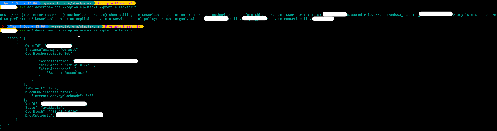

From `LabAdmin`, which has AdministratorAccess, creating an IAM user works, and creating an access key for it is denied by the SCP. The test user was deleted afterward. `deny-leave-org` isn't tested: leaving would fail anyway because `lab` has no standalone payment method, so the result would prove nothing.

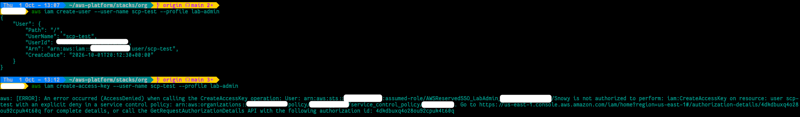

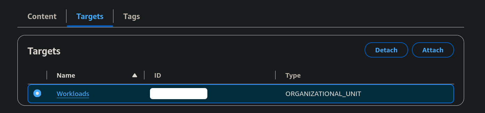

### Organization CloudTrail

One organization trail, `org-trail`, records management events from every account in the organization, in every region. It was created in the management account, with `us-west-2` as its home region. It includes global service events, has log file validation on, records both read and write management events, and records no data events, which are billed per event and nothing here needs yet. It started in project 1 because project 5 generates least-privilege policies from CloudTrail history, and the earlier it starts recording, the more history there is.

Logs land in an S3 bucket in the management account named `<prefix>-org-trail-<account-id>`, under `AWSLogs/<org-id>/<account-id>/CloudTrail/<region>/`. In a real organization this bucket would be in a dedicated log archive account. The bucket gets the same hardening as the state bucket: SSE-S3, all four public access block settings, bucket owner enforced, and a TLS-only deny. It has no versioning. A lifecycle rule expires log objects after 365 days.

The bucket policy lets CloudTrail check the bucket ACL and write log files, with every statement scoped by `aws:SourceArn` to this one trail. CloudTrail is shared by every AWS customer, so without that condition a trail in someone else's account could write into this bucket. CloudTrail checks the bucket policy when the trail is created, so the policy has to exist first and can't read the ARN from the trail. The trail ARN is built in a local from the region, the account ID, and the trail name instead. `depends_on` makes sure the bucket policy exists, and trusted access for CloudTrail is turned on, before the trail is created. Both the trail and its bucket have `prevent_destroy`.

Member accounts can see the organization trail, but they can't stop it, change it, or delete it, so no SCP is needed to protect it.

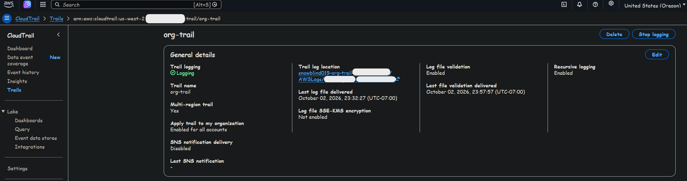

A trail only delivers events that happen after it exists. To test it, a few calls were made in `lab` after the apply, including the denied `eu-west-1` call from the SCP test, which gets logged too. Within minutes `lab` had its own folder under the organization's prefix, with `CloudTrail-Digest/` next to `CloudTrail/`. The digest files are the log file validation working: signed hourly digests that prove later whether a log file was changed or deleted.

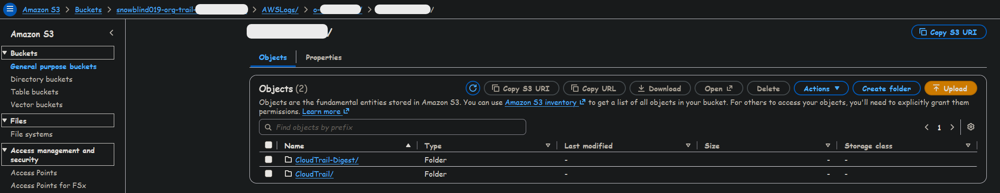

### Account defaults

The `foundation` stack sets three account-level defaults in `lab`. None of them cost anything, and each one closes a finding the posture scan in project 8 would otherwise report.

| Setting | Scope | What it does |
|---|---|---|
| S3 public access block | Whole account | All four settings on. It overrides any bucket's own setting, so no bucket in `lab` can be made public, including by a mistake in a later stack |
| EBS encryption by default | `us-west-2` and `us-east-1` | Every new volume is encrypted with the AWS managed `aws/ebs` key |
| IMDSv2 by default | `us-west-2` and `us-east-1` | New instances require session tokens for the metadata service. IMDSv1 is a plain GET, which is how SSRF bugs steal an instance role's credentials |

The two regional settings come from one block each, using the AWS provider's per-resource `region` argument with `for_each` over the allowed regions. Those regions are read from the `org` stack with `terraform_remote_state`, so the guardrails always cover the same list `region-lock` enforces. Adding a region there adds the guardrails here on the next plan.

IMDSv2 is a default, not enforcement. A launch that explicitly asks for IMDSv1 still gets it. The other metadata options are left at no preference, since the hop limit is a per-workload decision.

Destroying `foundation` turns all three off, and the rebuild turns them back on a few minutes later.

## Cost controls

Before any project 1 work, the account's month-to-date cost was $0.00, and all of August 2026 came to $0.02. That's the baseline the rest of this project is measured against.

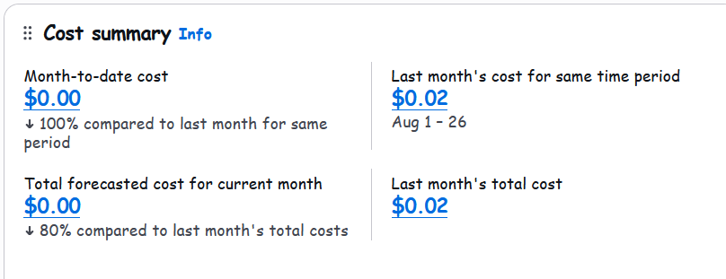

Two budgets in the management account cover every account in the organization:

| Budget | Period | Limit | Alerts |
|---|---|---|---|
| `daily-leak` | Daily | $3 | Actual spend over 100% |
| `monthly-ceiling` | Monthly | $25 | Actual spend over 80% and 100%, forecasted spend over 100% |

There's no zero-spend budget. The standing cost is above zero on purpose, so a zero-spend alert would fire every month and train me to ignore alerts. If `daily-leak` fires on a day I didn't work, something was left up overnight. Billing data updates a few times a day, so budgets react within hours, not minutes. The ephemeral check is the faster net.

Alerts go straight to email, with no SNS topic, at a separate plus-address so an inbox rule can sort them. The address comes from a gitignored `terraform.tfvars` and is marked sensitive.

A leftover hand-made $50 budget from before the project was deleted, so the code describes everything in the management account.

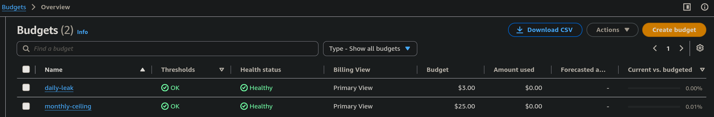

To prove an alert actually reaches me, `monthly-ceiling` was lowered to $0.01 until one came. The first try, in Phase 4, couldn't fire: month-to-date spend was about a quarter of a cent, under even the 80% line on a $0.01 budget. By mid-October spend was $0.09. This time the limit was lowered in the console instead of in the code, so the test value was never in `cost.tf` and couldn't get committed by mistake. The first console edit didn't save, and the budget sat at $25 for a day before `describe-budget` showed it, so the second try was checked from the CLI right after saving. The alert for actual spend over 100% arrived within a day of that. Then `terraform plan` in `org` showed the change as drift, `limit_amount` from `0.01` back to `25`, and one apply put it back.

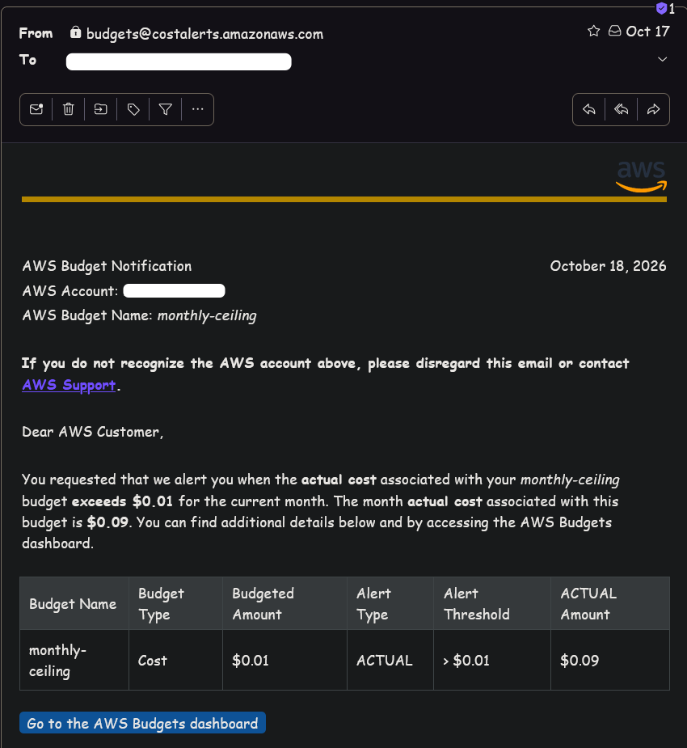

Cost Anomaly Detection runs an AWS services monitor, which learns what normal spend looks like for each service separately and flags spikes. AWS allows only one services monitor per account, so the default one AWS had created was deleted first, and this one was created in code. A daily summary email goes out only for anomalies with $5 or more of total impact. Smaller ones still show in the console.

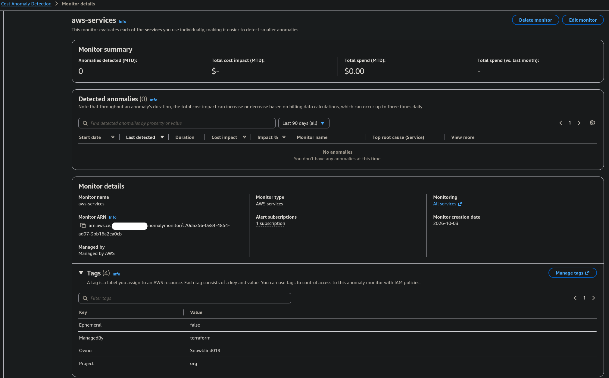

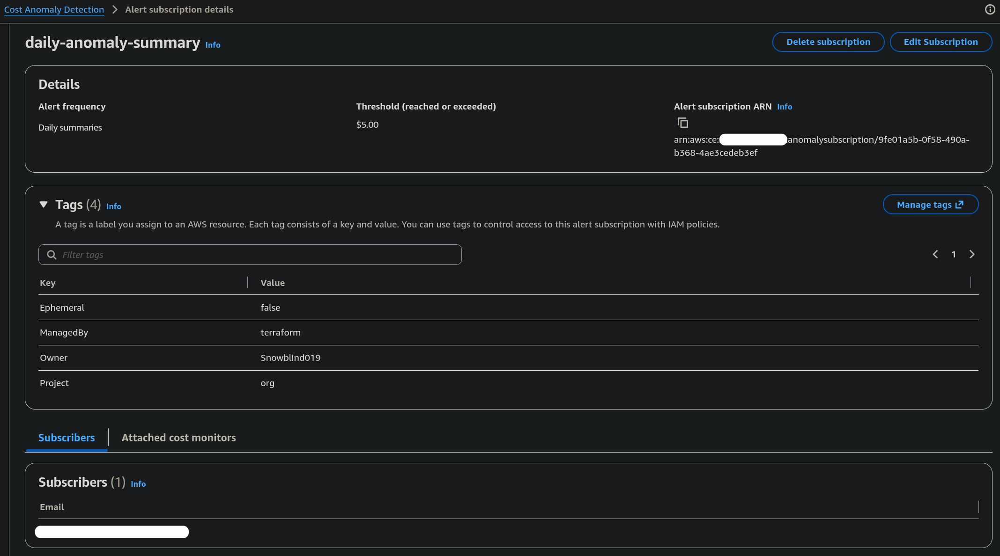

The four standard tag keys are active as cost allocation tags, so costs can be grouped by `Project` and the rest. The keys come from the tags module, `keys(module.tags.tags)`, so the module stays the only place the standard is defined. Only the Resource type is activated. The same four keys also show up as Account type, from the tags on the `lab` account itself, and those stay inactive for now. After activation, a backfill was requested so earlier tagged usage shows up in reports too.

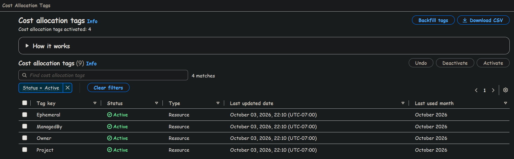

At first, Cost Explorer denied `OrgAdmin` even with AdministratorAccess. The management account had IAM access to billing information switched off, which keeps every billing page root-only no matter what a role's policies say. Root turned it on once, and billing work now goes through Identity Center like everything else.

Cost Explorer grouped by the `Project` tag shows which stack each cent came from. Usage from before the tags were active, and anything AWS bills without a resource tag on it, shows up with no `Project` value.

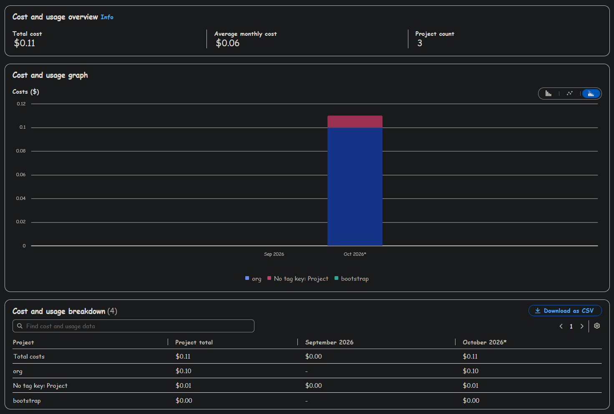

## GitHub OIDC and the ephemeral check

GitHub Actions gets into `lab` through OIDC, with no stored keys. Each workflow run asks GitHub for a signed token that says which repo and branch it came from. AWS checks the token against the IAM OIDC provider for `token.actions.githubusercontent.com`, then the role's trust policy, and hands back credentials that last at most one hour.

The provider accepts the audience `sts.amazonaws.com` and has no thumbprint. For GitHub, AWS checks the certificate against its own trusted CAs and ignores thumbprints, and a thumbprint set and later removed doesn't get cleared. There's one provider per URL per account, so the deploy roles in project 3 will reuse this one. Its ARN is a stack output for that reason.

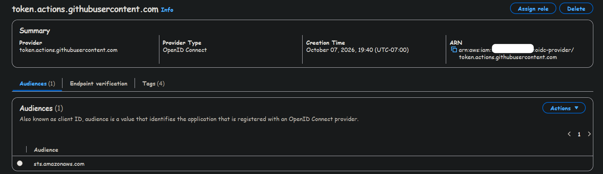

The role, `gha-ephemeral-check`, trusts that provider with two exact-match conditions:

| Condition key | Value |
|---|---|
| `token.actions.githubusercontent.com:aud` | `sts.amazonaws.com` |
| `token.actions.githubusercontent.com:sub` | `repo:Snowblind019@<owner-id>/aws-platform@<repo-id>:ref:refs/heads/main` |

The `sub` check is what keeps every other repository on GitHub out. Any workflow anywhere can ask for a token with the AWS audience, so a trust policy that checks only `aud`, or wildcards `sub`, lets any repo assume the role. Both use `StringEquals` with no wildcards.

The subject uses GitHub's immutable format, with numeric IDs after the owner and repo names. Repos created after July 15, 2026 get this format by default, and this one was created in September, so the older name-only subject in most examples would never match. The IDs are assigned once and never reused, so a renamed or deleted repo's name can't be taken over to get a matching token.

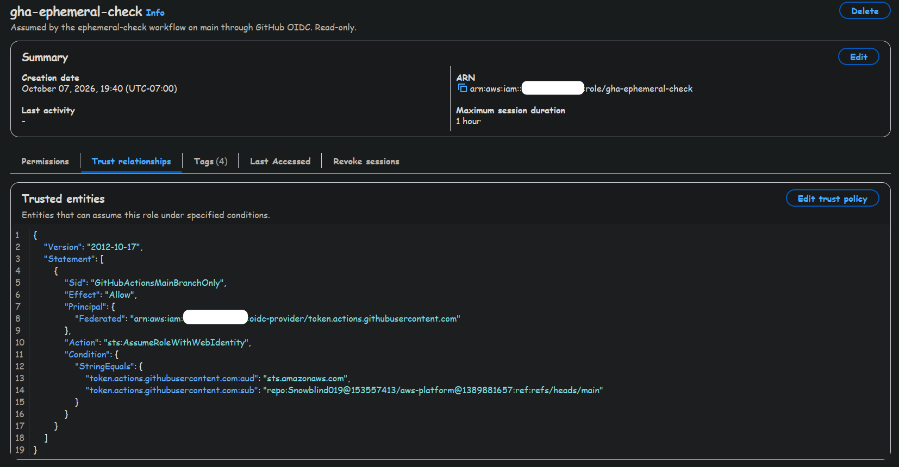

The role can do three things and nothing else: `tag:GetResources`, `ec2:DescribeNatGateways`, and `ec2:DescribeAddresses`, all read-only, in an inline policy. None of them support resource-level permissions, so the resource is `*` and the short action list is where least privilege comes from. `region-lock` already keeps it to the two allowed regions. The IAM policy simulator shows the three actions as allowed and `ec2:DescribeInstances` and `s3:ListAllMyBuckets` as implicit deny. The role has a fixed name, so a rebuild gives it the same ARN, and sessions last at most an hour.

On GitHub, the role ARN is stored as the repository secret `AWS_EPHEMERAL_CHECK_ROLE_ARN`. It isn't a credential, but as a secret it's masked in the public logs, which keeps the account ID out of them. The regions are plain repository variables, `AWS_REGION` and `AWS_ALLOWED_REGIONS`.

### The ephemeral check

`.github/workflows/ephemeral-check.yml` runs every day at 14:17 Pacific, before my shift starts, and can also be started by hand from the Actions tab. It uses the role above to count three things in each allowed region:

| Check | API call | Why |
|---|---|---|
| Resources tagged `Ephemeral=true` | `tag:GetResources` | Anything a project marks to be torn down after a session |
| NAT gateways that are pending or available | `ec2:DescribeNatGateways` | Bills by the hour, so it's counted whatever its tags say |
| Elastic IPs | `ec2:DescribeAddresses` | Bills by the hour, so it's counted whatever its tags say |

If any count is above zero, the run fails. The failed run is the alert: GitHub emails me, with Actions notifications set to email on failed workflows only, so a green run every day stays quiet. The logs and the job summary show counts only, never ARNs or resource IDs, because logs on a public repo are public. A count is enough to know to go look with `lab-readonly`.

How the workflow is locked down:

- The job's only permission is `id-token: write`, which lets it ask GitHub for an OIDC token. It never checks out the repo, so it doesn't get `contents: read`.
- `aws-actions/configure-aws-credentials` is pinned to the full commit SHA of v6.3.0. A tag can be moved to point at different code, a SHA can't, and this is the action that hands out the AWS credentials.
- The session lasts 15 minutes, the shortest STS allows. The check takes under a minute.
- The account ID is masked in the logs. The action doesn't do that by default.
- A failed assume-role is retried 3 times instead of the default 12, so a denied run fails fast instead of hanging.
- If `AWS_ALLOWED_REGIONS` is empty, the run fails. Otherwise it would check zero regions and go green having looked at nothing.
- The job doesn't use a GitHub environment. An environment changes the token's subject to `...:environment:<name>`, and the trust policy only matches `ref:refs/heads/main`.
- The runner is pinned to `ubuntu-24.04` instead of `ubuntu-latest`, and the job times out after 10 minutes.

The schedule uses GitHub's `timezone` key set to `America/Los_Angeles`, so the run stays at the same local time through daylight saving instead of moving an hour like a plain UTC cron would. It runs at minute 17 because the top of the hour is when GitHub's scheduler is busiest and runs get delayed. Scheduled runs can still start late, so it's "around 14:17," not exactly.

#### The three tests

**Green.** A manual run on `main` assumed the role and counted 0 for all six checks.

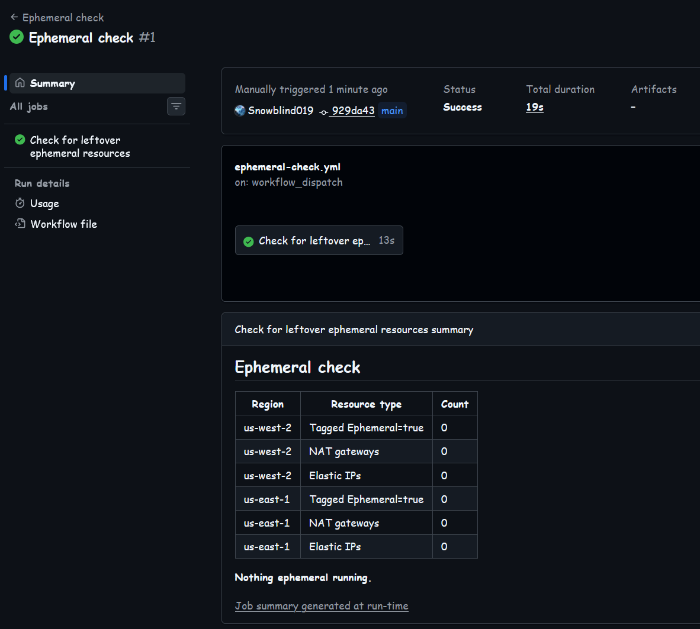

**Red.** A tagged SSM standard parameter, which is free, made the run fail with a count of 1 in `us-west-2`, and the failure email arrived a few minutes later. After the parameter was deleted, the next run went green again.

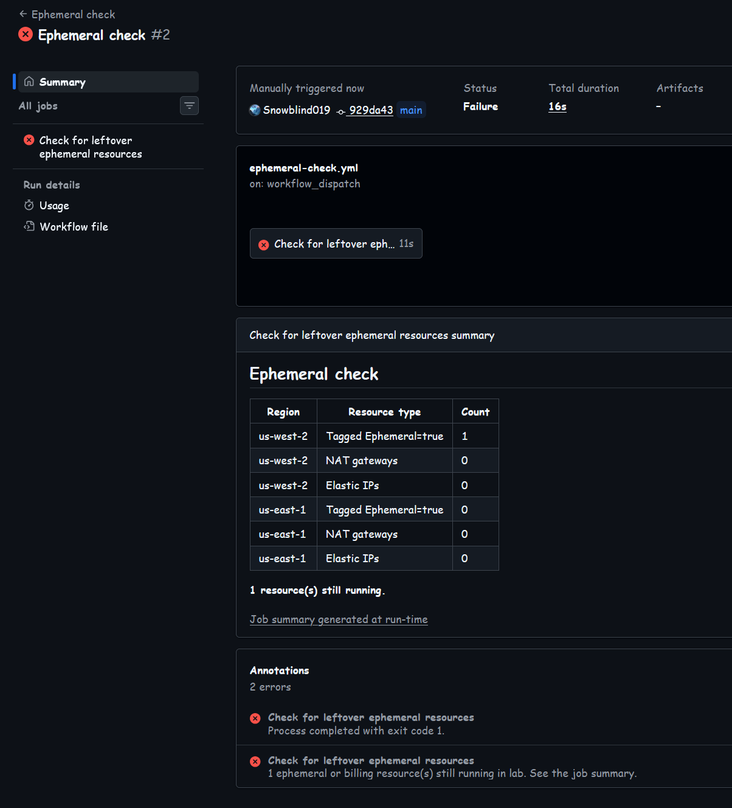

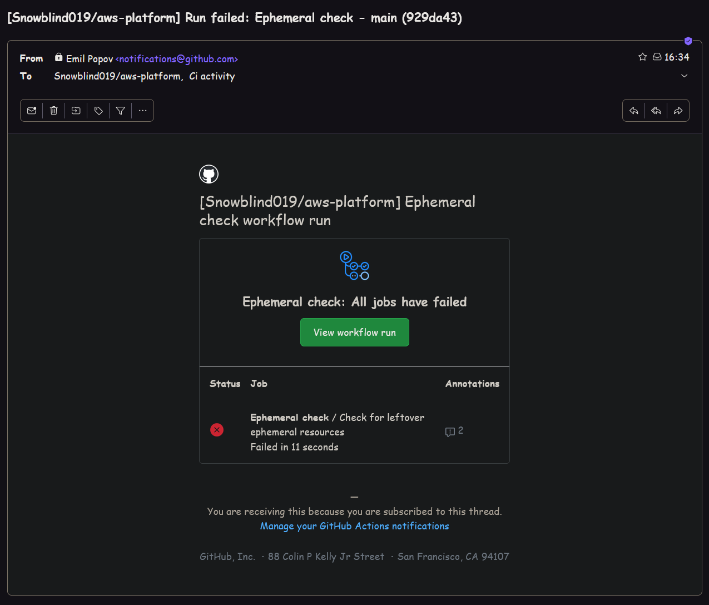

**Denied.** A manual run from a branch called `test-oidc-deny` used the same workflow file, secret, and role as the green run. The only difference was the branch, which changed the token's subject to `...:ref:refs/heads/test-oidc-deny`. The `sub` condition didn't match, so the credentials step failed with `Not authorized to perform sts:AssumeRoleWithWebIdentity` and the count step never ran. The branch was deleted afterward.

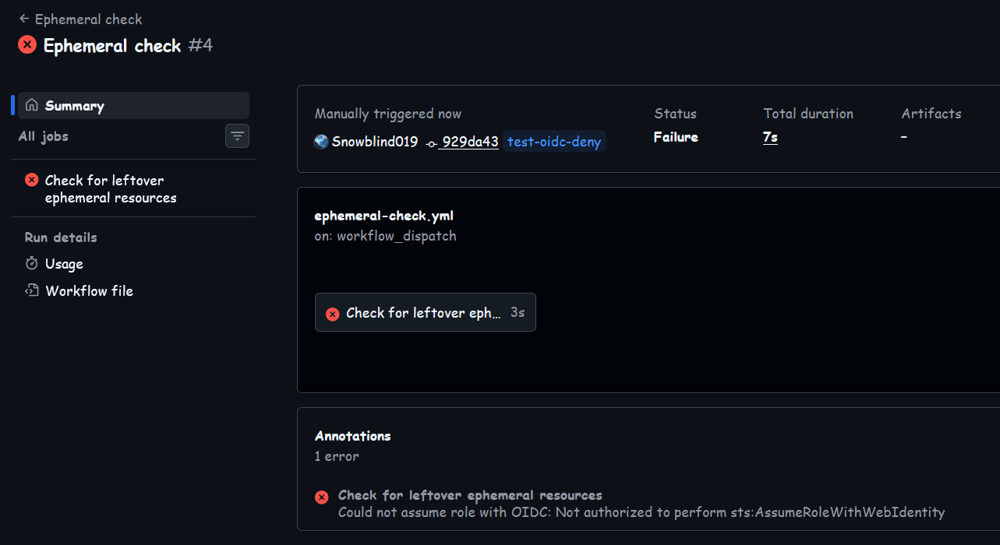

#### Reproducing the red test

```bash
aws ssm put-parameter \
  --name /snowblind019/ephemeral-check-test \
  --type String \
  --value red-test \
  --tags Key=Ephemeral,Value=true \
  --region us-west-2 \
  --profile lab-admin
```

Run the workflow on `main` from the Actions tab and it fails with a count of 1. Then delete the parameter:

```bash
aws ssm delete-parameter \
  --name /snowblind019/ephemeral-check-test \
  --region us-west-2 \
  --profile lab-admin
```

The next run goes green once the tagging API stops listing the parameter. The name can't start with `aws` or `ssm`: Parameter Store reserves those for AWS's own parameters, including the first level of a path, so `/aws-platform/...` is rejected.

#### Things to know

- GitHub turns off scheduled workflows in public repos after 60 days with no activity in the repo. The Actions tab then shows an Enable workflow button on it.
- The email for a scheduled run goes to whoever last edited the `cron` line. For a manual run, it goes to whoever started it.
- The check only covers `lab`. Nothing gets built in the management account, and the role only exists in `lab`.

## Drift and rebuild

With all three stacks applied, `terraform plan -detailed-exitcode` returned exit code 0 in each one, meaning the code and AWS match exactly. Exit code 2 means changes are pending and 1 means an error, so a scheduled job can act on the number without reading the output. Before that, two leftovers came out of the `org` stack: the import blocks, and a tag policy file for a stretch item that was skipped.

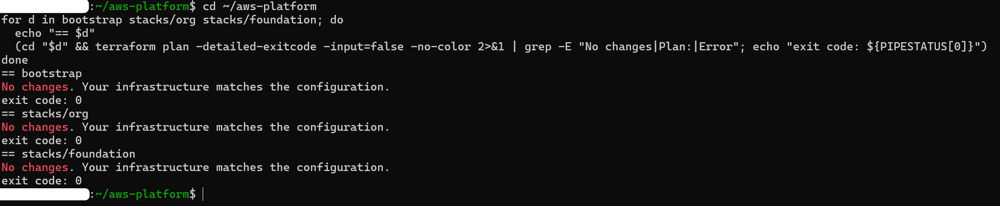

To test drift, I added `s3:ListAllMyBuckets` to the `gha-ephemeral-check` role's inline policy by hand in the console. That's the kind of drift that matters: a role quietly getting more access than the code gives it. A refresh-only plan in `foundation` showed the extra permission as a change made outside of Terraform. The normal plan planned to remove it and exited with code 2. One apply put the policy back to its three actions.

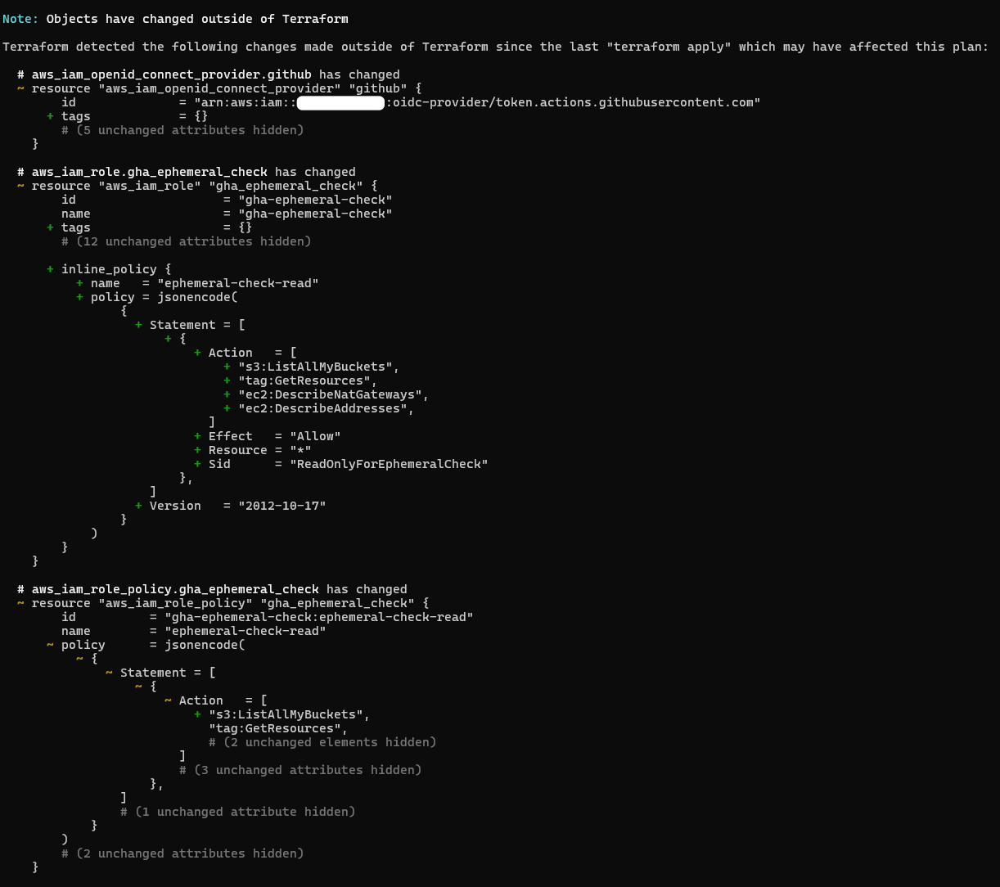

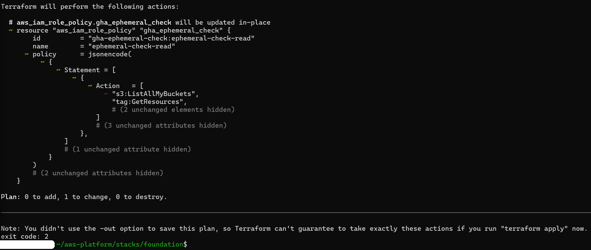

The refresh-only plan also listed the OIDC provider and the role. Both showed an empty `tags = {}` that the state had no value for, which isn't a real change. The role also showed the whole inline policy as new, because `aws_iam_role` reads back every inline policy attached to it, while `aws_iam_role_policy` is the resource that owns this one. When two resources can describe the same thing, a refresh reports the drift on both. The normal plan showed only the one real change.

Plan shows what changed, and CloudTrail shows who. Both `PutRolePolicy` calls, my console edit and Terraform's revert, are in the `lab` account's event history under my Identity Center session, about 40 minutes apart. The user agent tells them apart.

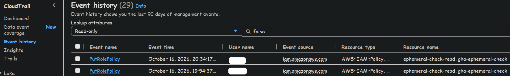

Plan only checks resources that are already in state. A resource someone creates by hand, outside every stack, never shows up in any plan. That's what the ephemeral check, and AWS Config in project 8, are for.

Then `foundation` was destroyed and built again from code: the three account defaults, the OIDC provider, and the role, 8 resources in all. The destroy took about 16 seconds, most of it the S3 account public access block, and the apply took about 2. The role and the provider have fixed names, so their ARNs came back the same, the outputs matched the ones saved before the destroy, and the ephemeral check went green on the rebuilt role with nothing changed on GitHub. The account defaults were checked directly in both regions after the apply instead of trusting the apply output.

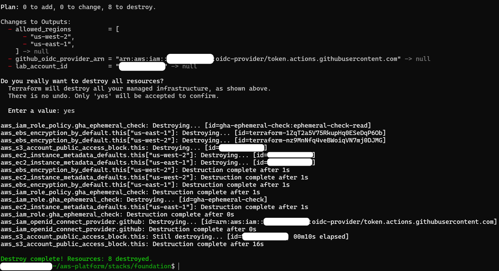

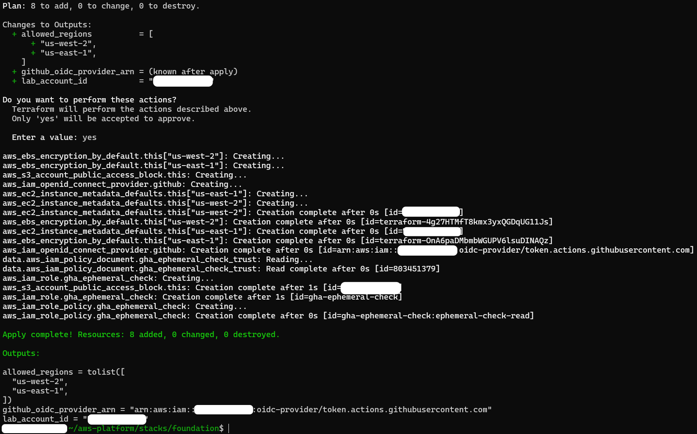

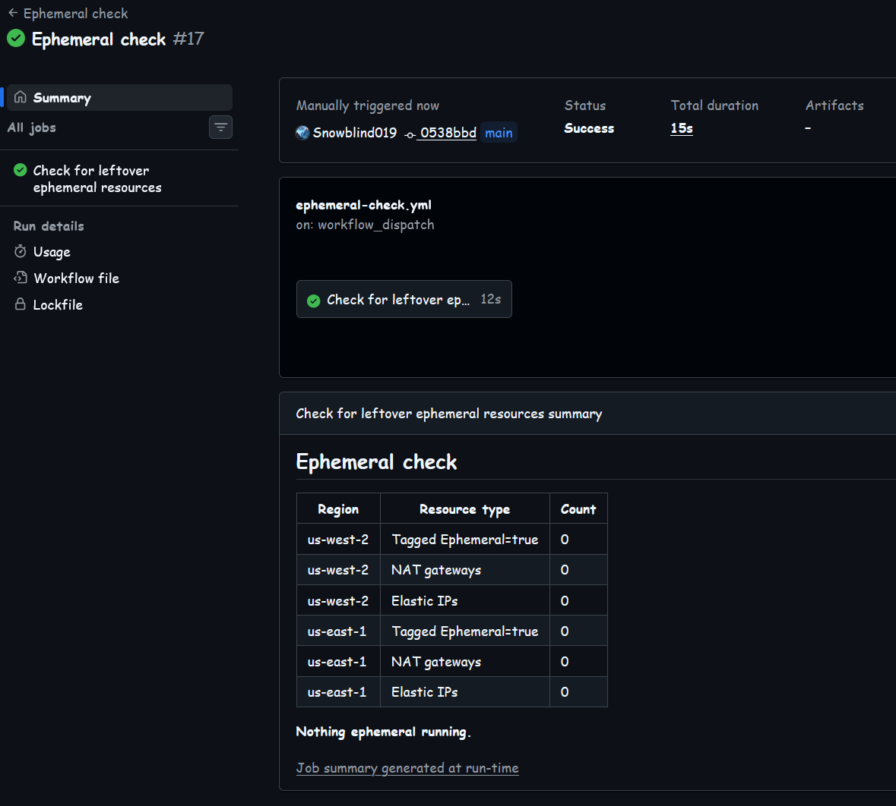

A rebuilt role has the same name and ARN but a new internal ID. Bucket and key policies that name a role store that ID when they're saved, so they stop matching a recreated role with no error. Nothing names this role that way. Later stacks that put a role from another stack in a resource policy will have to keep this in mind.

`bootstrap` and `org` weren't part of this. They hold the state bucket and the organization itself, and `prevent_destroy` makes `terraform destroy` in either one fail during the plan, before anything is deleted.

## Outputs

| Output | Description | Used by |
|---|---|---|
| `allowed_regions` (`org`) | Regions the `lab` account may use, the same list `region-lock` enforces | `foundation`, through `terraform_remote_state` |
| `organization_id` (`org`) | The organization's ID. Log paths in the CloudTrail bucket start with it | Finding the log folders |
| `lab_account_id` (`org`) | Account ID of the `lab` member account | Reference |
| `trail_bucket_name` (`org`) | The S3 bucket holding the organization CloudTrail logs | Finding the logs |
| `allowed_regions` (`foundation`) | The same regions, passed through from `org` | Every later regional stack |
| `github_oidc_provider_arn` (`foundation`) | ARN of the GitHub OIDC provider in `lab` | Project 3's deploy roles |
| `lab_account_id` (`foundation`) | The `lab` account's ID, from the account the stack runs in | Stacks that build ARNs or bucket names |

Later stacks read `foundation` only, never `org`, and only through its outputs. If a later stack needs something that isn't here, it becomes a new output instead of a data source lookup.

## Testing the guardrails

Every guardrail in this project can be checked again at any time. Each check says which profile to use and what a working guardrail looks like. Run `aws sso login` first, and run the commands from the repo root.

### Code matches AWS

```bash
export AWS_PROFILE=lab-admin
for d in bootstrap stacks/org stacks/foundation; do
  echo "== $d"
  (cd "$d" && terraform plan -detailed-exitcode -input=false -no-color 2>&1 | grep -E "No changes|Plan:|Error"; echo "exit code: ${PIPESTATUS[0]}")
done
```

Three `No changes.` lines and three `exit code: 0`. Exit code 2 means something drifted, and `terraform plan -refresh-only` in that stack shows what changed outside of Terraform.

### Region lock

```bash
aws ec2 describe-vpcs --region eu-west-1 --profile lab-admin
aws ec2 describe-vpcs --region us-west-2 --profile lab-admin --query 'length(Vpcs)'
```

The first fails with `UnauthorizedOperation` and an explicit deny in a service control policy. The second prints a number.

### No new access keys in `lab`

```bash
aws iam create-user --user-name scp-key-test --profile lab-admin
aws iam create-access-key --user-name scp-key-test --profile lab-admin
aws iam delete-user --user-name scp-key-test --profile lab-admin
```

Creating the user works. Creating the key fails with `AccessDenied` and an explicit deny in a service control policy, even though `LabAdmin` has AdministratorAccess. The last command cleans up.

### No access keys anywhere

```bash
aws iam generate-credential-report --profile lab-admin
aws iam get-credential-report --profile lab-admin --query Content --output text | base64 -d | cut -d, -f1,9,14
```

Run both again with `--profile mgmt-admin` for the management account. If the first command says `STARTED`, run it again until it says `COMPLETE`. Columns 9 and 14 are whether each of a user's two access keys is active, so every row should end in `false,false`, root included.

### `lab` has no root credentials

In the management account, open IAM, Root access management. The `lab` row shows its root user credentials as not present.

### State locking

In `bootstrap`, run `terraform apply -replace=aws_s3_bucket_ownership_controls.state` in one terminal and leave it at the prompt. `terraform plan` in a second terminal fails with `Error acquiring the state lock`. Answer `no` in the first terminal to release it.

### `prevent_destroy`

```bash
cd bootstrap
terraform plan -destroy
```

The plan fails with `Instance cannot be destroyed`, and nothing can be applied. `org` fails the same way.

### GitHub trust only from `main`

Start the ephemeral check from the Actions tab on any branch other than `main`. The credentials step fails with `Not authorized to perform sts:AssumeRoleWithWebIdentity`. The same run on `main` goes green. The red test above shows the check catching an ephemeral resource.

## Decisions

Every choice, with what I passed on and why, is in [decisions.md](../decisions.md). These are the calls that shaped the project most:

- **Three stacks split by account.** `org` runs against the management account, `bootstrap` and `foundation` against `lab`. No plan ever touches two accounts.
- **Accounts created by hand, then imported with `prevent_destroy`.** Creating and closing accounts can't be undone, so the code describes them without being able to delete them.
- **No long-lived credentials anywhere.** Identity Center for people, OIDC for GitHub, an SCP that blocks new IAM user keys in `lab`, and no root credentials in `lab`.
- **Native S3 state locking** instead of a DynamoDB table, with partial backend config so the bucket name and the account ID in it stay out of the repo.
- **SCPs as deny statements on the `Workloads` OU,** with the region-lock exemptions taken from the Control Tower controls reference instead of written from memory.
- **The GitHub trust matches the exact subject,** in GitHub's immutable format, for `main` only, with `StringEquals` on both `aud` and `sub`.
- **A failed workflow run is the ephemeral check's alert.** No SES or SNS, and nothing extra on the role.
- **Daily and monthly budgets instead of zero-spend,** so an alert means something.
- **Later stacks read `foundation`'s outputs and nothing else.** A missing value becomes a new output.
- **Known gaps written down** with the project that closes each one, instead of building the production version of everything in project 1.

## What broke

Rows with an issue number were tracked as bug issues. The rest were found and fixed in the same sitting.

| Problem | Cause | Fix |
|---|---|---|
| The first import plan wanted to disable resource control policies for the whole organization | RCPs were enabled on the root, but `enabled_policy_types` only listed SCPs, and Terraform treats that list as the whole truth | Added `RESOURCE_CONTROL_POLICY` to the list before applying |
| A plan on a second machine failed with a state lock error ([#10](https://github.com/Snowblind019/aws-platform/issues/10)) | An earlier interrupted `plan` from the same machine left its `.tflock` object behind | Confirmed no other run was active, then `terraform force-unlock` |
| A plan on a second machine wanted to destroy and replace the `lab` account | That machine's `terraform.tfvars` had the `lab` email typed slightly differently, and a different email forces replacement | `prevent_destroy` stopped the plan. Copied the exact address from `aws organizations list-accounts` |
| `terraform init` on a second machine failed with `InvalidClientTokenId` | `AWS_PROFILE` wasn't set, so the SDK fell back to the deleted IAM user's keys still sitting in that machine's `~/.aws/credentials` | Removed the old keys and exported `AWS_PROFILE=lab-admin` |
| Cost Explorer denied `OrgAdmin` despite AdministratorAccess | IAM access to billing information was off in the management account | Root turned it on in the account settings |
| Creating the red test's SSM parameter failed with `AccessDeniedException: No access to reserved parameter name` | The name started with `/aws-platform`. Parameter Store reserves every name that starts with `aws` or `ssm`, in any case, including the first level of a path. A delete using the old name failed the same way, so the renamed parameter was still there | Renamed it to `/snowblind019/ephemeral-check-test` and deleted it with that name |
| `org` still held the import blocks and a tag policy file for a skipped stretch item, so its plan wanted to create a tag policy ([#11](https://github.com/Snowblind019/aws-platform/issues/11)) | The import file was redacted instead of deleted, and the tag policy file stayed after the stretch item was dropped. Nothing had run a plan in `org` since | Deleted both files, and the plan showed no changes |
| `terraform plan` failed with `fork/exec ... terraform-provider-aws ...: permission denied` on the work PC, in two stacks | The downloaded provider binary in the local `.terraform` folder had lost its execute permission, and `terraform init` reused it | Deleted `.terraform` and ran `init` again for a fresh download |
| The three stacks ran three different AWS provider versions across the two machines | The `.terraform.lock.hcl` files were never committed, so each machine picked its own version | Upgraded all three stacks to the same version and committed the lock files |

## Known gaps

Each of these is a real answer to "what would you do differently in production," and most of them are closed by a later project.

- **No dedicated log archive or security tooling accounts.** The CloudTrail bucket lives in the management account, and a real organization keeps logs and security tooling in accounts of their own. Two accounts is the smallest layout that still shows SCPs, cross-account access, and org-level services.
- **State lives in `lab`, the account the pipeline will deploy into.** A real setup keeps state in a separate tooling account, out of reach of the deploy roles. It also puts `org`'s state in the account its own SCPs govern: a bad `region-lock` could block Terraform from the state it would need to fix it, and the way back is a manual detach in the console. Revisit in projects 3 and 5.
- **Permission sets use AWS managed AdministratorAccess, and Identity Center isn't in Terraform yet.** Project 5 scopes them down and imports them.
- **`OrganizationAccountAccessRole` is still in `lab`.** It's kept as break-glass. Projects 5 and 8 decide whether it stays.
- **No customer managed KMS key.** State, trail logs, and EBS volumes use AWS owned or AWS managed keys. One gets added to `foundation` when the first stack needs it, likely project 4 or 6.
- **Trail logs use SSE-S3, not KMS.** Project 8's Security Hub scan will flag it.
- **The trail's log bucket has no versioning or Object Lock.** Log file validation can prove a log file was changed or deleted, but it doesn't stop someone with admin in the management account from deleting it.
- **AWS Config, GuardDuty, and Security Hub are off.** Project 8.
- **`region-lock` exemptions apply in every region.** Anything on the `NotAction` list, like `kms:*`, still works in regions the policy otherwise denies.
- **IMDSv2 is the default, not enforced.** An SCP condition on `ec2:MetadataHttpTokens` or an EC2 declarative policy would enforce it. Project 8.
- **`AWS_ALLOWED_REGIONS` in GitHub is a hand copy of `org`'s list.** If the list changes, the variable has to change with it.
- **The remote state read gives `foundation` all of `org`'s state.** That includes the two email addresses in plain text. Fine while one principal can read the whole bucket anyway. With separate teams, shared values would go somewhere narrower, like SSM Parameter Store.
- **The ephemeral check turns itself off after 60 quiet days.** GitHub disables scheduled workflows in public repos when nothing happens in the repo for 60 days, so a long break stops the check without any warning.
- **The ephemeral check only sees what it looks for.** It counts resources tagged `Ephemeral=true`, NAT gateways, and Elastic IPs. Something made by hand without tags, like an EC2 instance, wouldn't show up. Later projects add a direct check, and the read permission for it, for anything else that bills while untagged.
- **The tagging API can lag behind deletes.** AWS doesn't say how fast a deleted resource drops out of `tag:GetResources` results, and other people have seen them listed for hours. In the red test the deleted parameter was gone by the next run, but a check right after a `terraform destroy` could still go red for something that's already gone. A direct describe call on the resource settles it.
- **Drift is only caught when someone runs `plan`.** Nothing runs it on a schedule yet. Project 3's pipeline can run `plan -detailed-exitcode` on a schedule and fail on exit code 2.

## Cost

| Item | Amount |
|---|---|
| Baseline before the project | $0.00 month to date on 09-26-2026 ($0.02 for all of August 2026) |
| Standing monthly cost | About $0.15. Nearly all of it is S3 for the `org` stack's CloudTrail log bucket, since every log file the trail delivers is a request. The state bucket rounds to $0.00. These have no charge: Organizations, SCPs, Identity Center, IAM and the OIDC provider, the first copy of management events in CloudTrail, budgets without actions, and Cost Anomaly Detection |
| Actual spend during the project | $0.11 from 09-25-2026 to 10-21-2026: $0.10 for `org`, $0.01 with no `Project` tag, and $0.00 for `bootstrap` (S34) |

## Tested with

| Tool | Version |
|---|---|
| Terraform | v1.16.4 |
| AWS provider | 6.66.0 |
| AWS CLI | 2.37.4 |