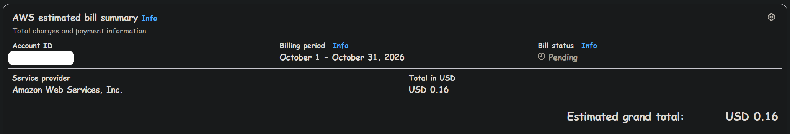
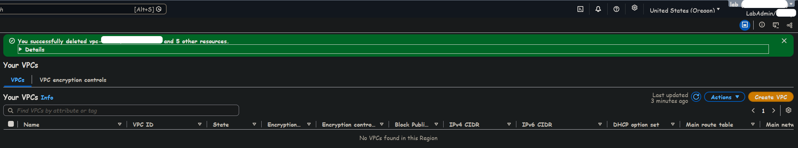
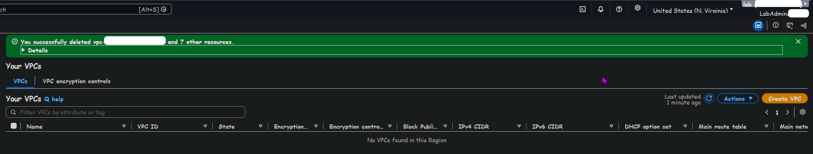

# Project 2: Multi-VPC Network

**Status:** In progress\
**Started:** 10-29-2026\
**Finished:**

Sections fill in as each phase of the build closes. Progress is tracked in the [Project 2 milestone](https://github.com/Snowblind019/aws-platform/milestone/2).

<!-- One-line summary once built: what this network gives the stacks after it. -->

## Overview

<!-- One paragraph: hub and spoke in CloudFormation, a fully private shared services VPC, inspection and egress in one VPC, and what later stacks get from it. -->

## Architecture

<!-- D2 page 1:  -->
<!-- D2 page 2:  -->
<!-- D2 page 3:  -->

## Stacks

| Stack | Account | What it holds | Lifecycle |
|---|---|---|---|
| `cfn-bootstrap` | lab | | Persistent |
| `cfn-drills` | lab | | Ephemeral |
| `network` | lab | | Ephemeral |
| `network-test` | lab | | Ephemeral |
| `org-stacksets` | management | | Persistent |
| `spoke-vpc.yaml` | n/a | | n/a |

## Running it

### The session loop

### Parameters

### Cost

Before any project 2 work, October's bill so far was $0.16. That's the baseline this project's cost gets measured against.

<!--  -->
<!--  -->

## CloudFormation setup

<!--  -->
<!--  -->
<!--  -->
<!--  -->
<!--  -->

## CloudFormation drills

| Drill | What broke | Status it left | How I found it | Way out |
|---|---|---|---|---|
| C1 | | | | |
| C2 | | | | |
| C3 | | | | |
| C4 | | | | |
| C5 | | | | |
| C6 | | | | |
| C7 | | | | |
| C8 | | | | |

<!--  -->
<!--  -->
<!--  -->
<!--  -->
<!--  -->
<!--  -->
<!--  -->
<!--  -->
<!--  -->
<!--  -->
<!--  -->
<!--  -->
<!--  -->
<!--  -->

## Address plan

The default VPCs in `lab` were deleted in us-west-2 and us-east-1 before anything was built, so nothing can land in a VPC with a public route by mistake.

## VPCs

<!--  -->
<!--  -->
<!--  -->
<!--  -->
<!--  -->
<!--  -->

## Transit Gateway

<!--  -->
<!--  -->
<!--  -->
<!--  -->

## The fully private spoke

<!--  -->
<!--  -->
<!--  -->
<!--  -->
<!--  -->

## Contract

| Export or parameter | What it is | Read by |
|---|---|---|

<!--  -->

## Network Firewall

<!--  -->
<!--  -->
<!--  -->
<!--  -->
<!--  -->
<!--  -->
<!--  -->

## DNS

<!--  -->
<!--  -->
<!--  -->
<!--  -->
<!--  -->

## VPC endpoints

<!--  -->
<!--  -->
<!--  -->
<!--  -->
<!--  -->

## Baseline

<!--  -->
<!--  -->
<!--  -->
<!--  -->

## Patching and hardening

| Scan | Passed | Failed | Skipped |
|---|---|---|---|
| CIS Level 1, before STIG | | | |
| CIS Level 1, after STIG Medium | | | |

<!--  -->
<!--  -->
<!--  -->
<!--  -->
<!--  -->
<!--  -->
<!--  -->
<!--  -->

## Flow logs and troubleshooting

<!--  -->
<!--  -->
<!--  -->
<!--  -->
<!--  -->

The full walk of every path is in [packet-walk.md](packet-walk.md).

## Drills

| Drill | What broke | Symptom | Found with | Drift detection said | Fix |
|---|---|---|---|---|---|
| N1 | | | | | |
| N2 | | | | | |
| N3 | | | | | |
| N4 | | | | | |
| N5 | | | | | |
| N6 | | | | | |
| N7 | | | | | |
| N8 | | | | | |

<!--  -->
<!--  -->
<!--  -->
<!--  -->
<!--  -->
<!--  -->
<!--  -->
<!--  -->
<!--  -->
<!--  -->
<!--  -->
<!--  -->
<!--  -->
<!--  -->
<!--  -->
<!--  -->

## Proving it

<!--  -->
<!--  -->
<!--  -->
<!--  -->
<!--  -->
<!--  -->
<!--  -->

## Decisions

<!-- The main calls, each linking to its row in ../decisions.md -->

## What broke

| Problem | Cause | Fix |
|---|---|---|

## Known gaps

## Cost

<!--  -->
<!--  -->

## Tested with

| Tool | Version |
|---|---|
| AWS CLI | 2.39.2 |
| Session Manager plugin | 1.2.896.0 |
| cfn-lint | 1.59.0 |
| cfn-guard | 3.2.1 |
